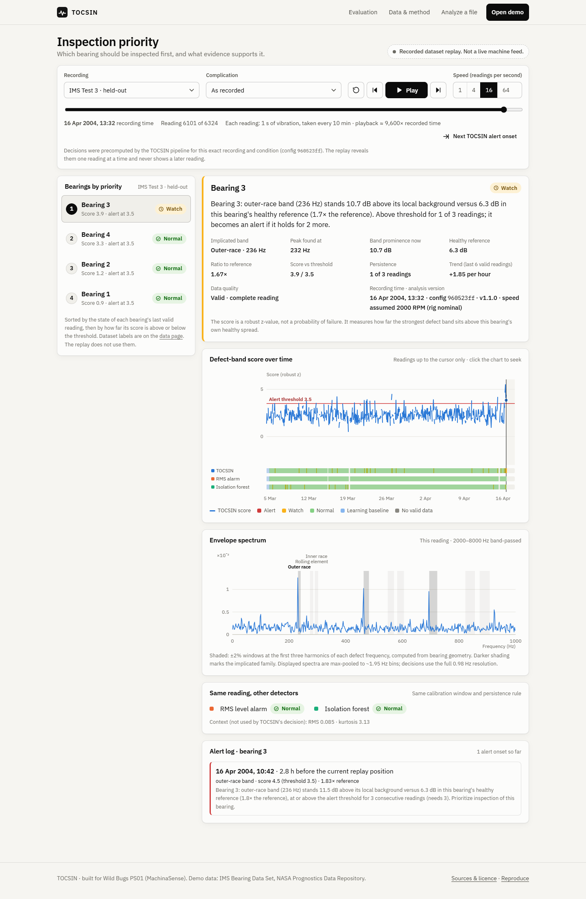

# TOCSIN

**See the vibration change. Inspect the evidence.**

TOCSIN turns bearing vibration recordings into inspection priorities with the measurements behind them. It is a research prototype, evaluated on recorded bearing tests. It is **not** a production monitoring system.

Built for **Wild Bugs PS01: MachinaSense** (intelligent industrial fault detection and predictive maintenance).

> **App:** https://tocsin-phi.vercel.app · **API:** https://tocsin-production.up.railway.app ([health](https://tocsin-production.up.railway.app/api/health), [version](https://tocsin-production.up.railway.app/api/version))
> Author: **Divine Dilibe** · Code licence: [MIT](LICENSE) · Data and third-party terms: [NOTICE.md](NOTICE.md)



---

## 1. Problem and intended user

Bearings often show changes in vibration before they fail. Smaller operators and maintenance teams may collect vibration readings but have no analyst to interpret them.

TOCSIN's job is **inspection triage**. It ranks bearings by how far a bearing-fault vibration pattern has moved from that bearing's own early readings, and it shows the measurements behind each priority.

## 2. What works today

| Mode | What it does | What it is not |
|---|---|---|
| **Recorded replay** (`/demo`) | Steps through real readings from three NASA/IMS run-to-failure tests. It reveals decisions the frozen pipeline computed in advance: priority list, alerts, evidence, spectrum, and seeded noise or missing-data conditions | A live feed. Pressing Play reveals stored results; it does not re-run the analysis |
| **Live file analysis** (`/analyze`) | Runs the pipeline on the server for one uploaded reading. It checks quality and compares the reading with a stored healthy reference of an IMS test bearing | General machinery monitoring. Only IMS-compatible readings are accepted (20 kHz, 2000 RPM, 20,480 samples, ZA-2115 geometry). One reading can reach WATCH at most |
| **Results** (`/evaluation`) | Held-out comparison with two baselines and ablations; the robustness grid; the pre-registered and corrected versions; the miss diagnosis | Evidence of reliable detection. There are only 2 held-out failures |

Monitoring your own machine (setup, machine-specific reference, upload history, inspection outcomes) is **not built**. See [docs/PRODUCT_GAP.md](docs/PRODUCT_GAP.md).

## 3. Judge quick start (about 3 minutes)

| Scenario | Link | What to look at |
|---|---|---|
| Understand an alert | [/demo/test3?guide=alert&b=3](https://tocsin-phi.vercel.app/demo/test3?guide=alert&b=3) | The evidence card (band, measurement vs reference, persistence), the score trend and the spectrum |
| Inspect the missed failure | [/demo/test2?guide=miss&b=1](https://tocsin-phi.vercel.app/demo/test2?guide=miss&b=1) | The RMS alarm alerts and TOCSIN does not. The spectrum peak sits just outside the outer-race window |
| See missing-data handling | [/demo/test2?guide=gaps&cond=gaps&b=1](https://tocsin-phi.vercel.app/demo/test2?guide=gaps&cond=gaps&b=1) | "No valid data", the reason, and the last valid measurement with its age |
| Analyze a supported sample | [/analyze?sample=late](https://tocsin-phi.vercel.app/analyze?sample=late) | Press Analyze. The server runs the pipeline on a real IMS reading |
| Compare the methods | [/evaluation#glance](https://tocsin-phi.vercel.app/evaluation#glance) | Counts with denominators, P/R/F1 per bearing, robustness, and what was frozen vs explored |

Each scenario opens with a short note: what you are looking at, what the detector concluded, the evidence, and what it does not establish.

## 4. Pipeline

```
NASA IMS archive (SHA-256 verified) ──stream──► validate each reading (rate, length, missing, gaps, machine-stopped)
   ──► band-pass 2–8 kHz ──► Hilbert envelope ──► envelope spectrum (0.98 Hz)
   ──► prominence of each defect band (outer race, inner race, rolling element; ±2% of geometry-derived frequency, 3 harmonics)
   ──► robust z vs the same bearing's first 72 valid readings ──► max over families = score
   ──► persistence: 1 reading ≥ 3.5 → WATCH, 3 consecutive → ALERT, 3 below → clear; invalid readings freeze the state
   ──► priority list + evidence card (template sentence from the numbers; no language model)
```

- **Code:** `tocsin/` (pure functions), `scripts/` (offline pipeline), `server/` (FastAPI), `web/` (React + TypeScript).
- **Design:** [docs/ARCHITECTURE.md](docs/ARCHITECTURE.md).

## 5. PS01 mandatory requirements

| Requirement | How TOCSIN meets it | Evidence | Limitation |
|---|---|---|---|
| Ingest and analyze time-series data from industrial equipment | 9,464 one-second accelerometer readings (20 kHz) from bearing run-to-failure tests, plus live single-reading upload | `results/manifest.json` (per-file hashes, 0 parse errors) | One equipment type, one rig |
| Detect abnormal patterns or classify faults | Per-bearing defect-band detector with persistence. Each alert names the implicated fault family | `results/heldout.json`, `results/derived_metrics.json` | Weak detection: 1 of 2 held-out failures, 4 of 6 undamaged bearings alerted (below). No organiser dataset was found publicly, so public IMS data is used; confirmation with the organisers is pending |
| Alerts with sensor evidence, timestamp, severity/priority | Evidence card, recording timestamp, Watch/Alert state, priority rank, score vs threshold | Replay; `tocsin/explain.py` | The score is not a probability |
| Held-out evaluation with metrics | Thresholds frozen on Test 1; Tests 2 and 3 held out; event-level and bearing-level metrics with counts | [docs/EVALUATION_PROTOCOL.md](docs/EVALUATION_PROTOCOL.md), `results/v1.0_preregistered/` | 2 failure events. Only v1.0 is clean held-out evidence: v1.1's data-handling fixes were made after v1.0's held-out results were seen. Strict compliance for v1.1 needs a test set nobody has looked at; IMS has none left |
| A realistic complication | Quality checks and a no-verdict state; seeded noise (20/10/0 dB), dropped samples, 40% gaps and lost readings, each rerun through the full pipeline | `results/robustness.json`, `results/robustness_examples.json` | Changing operating conditions are not demonstrated (IMS runs at constant speed and load) |

Line-by-line map: [docs/PS01_REQUIREMENTS_MAP.md](docs/PS01_REQUIREMENTS_MAP.md).

**Labels and operating conditions available:**

- **Labels:** the damaged bearing(s) at the end of each test. There are no onset times.
- **Conditions:** constant 2000 RPM and a 6000 lb radial load.
- **Fault point:** the last recorded reading of each test.

## 6. Results, including the missed failure

Held-out IMS Tests 2 and 3. Unit: one bearing in one held-out test (2 damaged, 6 undamaged). Any alert counts. Current version v1.1.

| Detector | Failures alerted (recall) | Alerted bearings that were damaged (precision) | F1 | Test 2 B1: first alert before recording endpoint | Test 3 B3 | Alert h per undamaged bearing-day |
|---|---|---|---|---|---|---|
| **TOCSIN (submitted)** | **1/2** | **1/5** | **0.29** | **missed** | **40 h** | **0.24** |
| RMS level alarm | 2/2 | 2/8 | 0.40 | 47 h | 27 h | 0.47 |
| Isolation forest | 2/2 | 2/5 | 0.57 | 2.2 days | 27 h | 1.72 |
| Simpler variant A1 (no defect bands; ablation) | 2/2 | 2/6 | 0.50 | 48 h | 27 h | 0.17 |

Plainly:

- **The pre-registered hypothesis, "earlier and quieter", failed and is withdrawn.**
- TOCSIN **missed Test 2 bearing 1**. The real outer-race tone (~231 Hz) fell just outside the ±2% window around the computed 236.4 Hz.
- It gave the earliest warning on Test 3 bearing 3, and all five of its alert onsets there named the correct fault family (outer race).
- It had the fewest alert hours on undamaged bearings of the three main detectors, at the cost of a missed failure.
- Most undamaged-bearing alerts, for every detector, start in a run's final day, when the failing bearing shakes the shared shaft. Counting only alerts that began before the final 24 h, TOCSIN's precision is 1/2 (RMS 2/3, isolation forest 2/4).
- **Why the better-scoring simpler variant was not adopted:** choosing it after seeing these results would tune the final solution on its own test data. PS01 requires evaluation on data not used for tuning.
- **What changed after the first run:**
  - v1.1 fixes two data-handling defects found after the pre-registered v1.0 run. Both versions are reported. v1.0 had TOCSIN at 2/2, but its Test 2 "alert" came from machine-stopped readings.
  - The ±4% window is a post-hoc diagnosis, not evidence.
- Lead times run to the **recording endpoint** (last recorded reading), not to a measured failure time.

Full detail: the in-app Results page, `results/derived_metrics.json` and [docs/LIMITATIONS.md](docs/LIMITATIONS.md).

## 7. Robustness

- **Conditions:** seeded perturbations of the real recordings (`tocsin/complications.py`, seeds from a hash of run, bearing and condition):
  - additive noise at 20/10/0 dB SNR, with a fixed noise floor per bearing;
  - 5% and 20% of samples dropped;
  - 15% of readings losing a 40% contiguous block;
  - 30% of readings lost.
- **Method:** each condition reruns the full pipeline. The replay's Complication selector loads those actual outputs.
- **Verified state behaviour** (`results/robustness_examples.json`):
  - a failed reading shows "No valid data", never a fresh "normal";
  - a failed reading during an ALERT does not clear it;
  - persistence counting resumes after the gap without being advanced or reset by it;
  - across all stored replays, 39,324 failed readings were checked and none was shown with a verdict.
- **Degradation** under noise is reported in the robustness table.
- **Scope:** synthetic perturbations do not cover every real sensor fault.

## 8. Reproduce

macOS / Linux (Python 3.12):

```bash
python3 -m venv .venv
.venv/bin/pip install -r requirements-dev.txt
.venv/bin/python scripts/fetch_artifacts.py      # verified 49 MB demo bundle -> artifacts/
.venv/bin/python -m pytest -q tests               # expected: all tests pass
.venv/bin/python -m uvicorn server.app:app --port 8000
cd web && npm ci && npm run dev                   # http://localhost:5173
```

Windows (PowerShell): the same steps, using `py -3.12 -m venv .venv` and `.venv\Scripts\python`.

Full rebuild from the NASA archive (about 45 min, about 1.2 GB disk, needs `bsdtar`): `PYTHON=.venv/bin/python sh scripts/reproduce.sh`. Per-step commands are on the Results page under "Reproduce".

A clean-environment run (new venv, requirements only, bundle fetched from the release) is logged in `results/test-logs/clean_environment.txt`.

## 9. Deployment and efficiency

The **proposed deployment** is a browser app (Vercel) calling one small API service (Railway, Docker). It needs no GPU and no edge hardware. Demo artifacts come from a pinned, checksum-verified GitHub Release bundle; the build fails if verification fails. `/api/version` reports the commit, config hash and artifact bundle, and the footer flags a frontend/API mismatch.

| Measurement | Value | Where |
|---|---|---|
| Server-side analysis of one reading (parse, validate, features, score) | 34–38 ms median (two runs of 10) | Deployed Railway service |
| Same, laptop (median / p95) | 64 / 84 ms; signal processing alone 7 ms | Laptop (i7-10510U) |
| Same, pinned to one logical core | 64 / 90 ms | Laptop; no memory cap enforced |
| HTTP round trip on the laptop | 104 ms median | Local |
| Server memory | about 125 MB | Laptop |
| Cold start | about 5 s | Laptop |
| Learned state per bearing | 48 bytes | n/a |

- **Deployed round trips** from the build machine took 3–5 s, almost entirely the upload of a 0.55 MB file over its connection. They are recorded separately.
- **Not run:** a 0.5-CPU / 256 MB container benchmark (Docker was unavailable).
- **Sources:** `results/deploy.json`, `results/deploy-verification.json`.

## 10. Tests

| Record | Result | Log |
|---|---|---|
| Python unit, integration, API and audit regressions | 60 passed (also 60 passed in a clean venv with the release bundle) | `results/test-logs/pytest.txt`, `clean_environment.txt` |
| Frontend unit, type-check, lint | 10 passed; tsc clean; eslint 0 problems | `results/test-logs/vitest.txt`, `tsc.txt`, `eslint.txt` |
| Local browser, 3 viewports, same origin (flows, audit regressions, scenarios, axe WCAG A/AA scan, reduced motion) | 119 passed, 1 skipped (phone keyboard test) of 120 | `results/test-logs/playwright.txt` |
| Local browser, cross-origin (Vercel/Railway split), run separately | 119 passed, 1 skipped of 120 | `results/test-logs/playwright-cross-origin.txt` |
| Deployed browser and API checks | earlier build; to be rerun after the next authorized deployment | `results/test-logs/playwright-deployed.txt`, `results/deploy-verification.json` |

Not covered:

- physical phones;
- real sensor hardware;
- an accessibility certification (the axe scan is automated only);
- a load test of the public service.

Audit findings and their regression tests are in [docs/AUDIT_RESPONSE.md](docs/AUDIT_RESPONSE.md).

## 11. Limitations

- **Small evidence base:** 2 held-out failures, both outer race, on one constant-speed rig. Speed is assumed, not measured.
- **No onset labels:** lead time is measured to the recording endpoint.
- **Weak detection:** below both baselines on detection. The simpler variant did better.
- **Corrections after viewing results:** v1.1 changed data handling after the held-out run; the post-hoc analyses are labelled.
- **Narrow Analyze scope:** IMS-compatible readings only.
- **Not monitoring:** no machine onboarding, history or outcomes.

Full list: [docs/LIMITATIONS.md](docs/LIMITATIONS.md).

## 12. Licence, attribution, AI assistance

- **Code:** MIT, © 2026 Divine Dilibe.
- **Data:** IMS Bearing Data Set, NSF I/UCR Center for Intelligent Maintenance Systems, University of Cincinnati, with Rexnord. Distributed by the NASA Prognostics Data Repository. Not covered by the MIT licence; see [NOTICE.md](NOTICE.md).
- **Geometry:** Qiu, Lee & Lin (2006), *J. Sound Vib.* 289:1066–1090.
- **AI assistance:** this project was implemented with substantial help from an AI coding assistant (Claude), working under the direction of the author, Divine Dilibe. The assistance covered code, tests, documentation, the data pipeline and the evaluation runs. All reported numbers come from executed scripts whose outputs are committed under `results/`.
