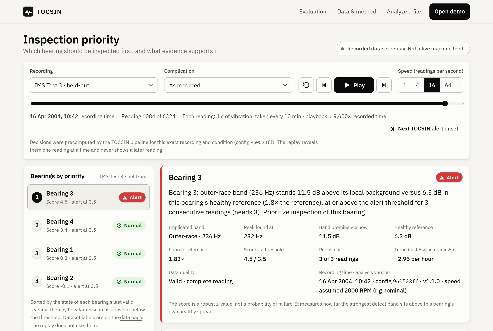

# TOCSIN

**Know which machine to inspect first, and see the evidence.**

TOCSIN ranks the bearings on a machine for inspection. It checks each bearing's own fault-frequency bands in the vibration envelope against that bearing's own healthy baseline, and it requires an exceedance to persist before raising an alert. Every alert names the defect band and shows the bearing's current level against its reference, how long the exceedance has held, the spectrum, the data quality and the analysis version.

It is built for a maintenance or reliability lead at a plant with rotating equipment who has accelerometer data but no vibration analyst on staff.

Built for **Wild Bugs PS01: MachinaSense**. The demo replays public run-to-failure recordings (IMS / NASA). It is **not a live machine feed**.

> **App:** https://tocsin-phi.vercel.app · **API:** https://tocsin-production.up.railway.app ([health](https://tocsin-production.up.railway.app/api/health)) · see [Deployment](#deployment)
>
> Author: **Divine Dilibe** · Licence: [MIT](LICENSE) for the original code; data and third-party terms in [NOTICE.md](NOTICE.md)



---

## Results in brief: read this before the numbers

Thresholds were frozen on IMS Test 1. IMS Tests 2 and 3 were held out. The held-out set has **2 failure events and 6 undamaged bearings**, far too few for percentages, so counts are reported.

**Pre-registered hypothesis:** TOCSIN would alert earlier than an RMS vibration-level alarm, with fewer alerts on undamaged bearings. **It was not supported, and that claim is withdrawn.**

Current version (v1.1), IMS Tests 2 and 3:

| Detector (same calibration window, persistence and threshold rule) | Failures alerted | First alert before recording endpoint: Test 2 B1 | First alert before recording endpoint: Test 3 B3 | Undamaged bearings alerted | Alert h per undamaged bearing-day |
|---|---|---|---|---|---|
| **TOCSIN** (defect-band envelope) | **1 of 2** | **missed** | **40 h** | 4 of 6 | **0.24** |
| RMS level alarm (tuned) | 2 of 2 | 47 h | 27 h | 6 of 6 | 0.47 |
| Isolation forest (time-domain stats) | 2 of 2 | 2.2 days | 27 h | 3 of 6 | 1.72 |
| *Ablation A1: broadband envelope, no defect bands* | *2 of 2* | *48 h* | *27 h* | *4 of 6* | *0.17* |

What this shows, plainly:

- **TOCSIN missed Test 2 bearing 1.** A post-hoc diagnosis found the observed outer-race tone at **~231 Hz**. TOCSIN's ±2% window around the computed 236.4 Hz (nominal 2000 RPM) starts at 231.7 Hz, so the tone fell outside it. Widening the window to ±4% catches both failures, at the cost of more undamaged-bearing alerts. That variant was designed after the held-out results were seen, so it is **not** held-out evidence, and the deployed detector stays at ±2%.
- **TOCSIN gave the earliest warning on Test 3 bearing 3** (40 h vs 27 h) and spent the **least time alerting on undamaged bearings** of the three main detectors.
- **The broadband-envelope ablation (A1) did better than full TOCSIN on these two runs.** As configured, the defect-band step cost a detection.
- **Most undamaged-bearing alerts, for every detector, fall in each run's final day.** By then the failing bearing shakes the shared shaft.
- **Two ingestion defects** were found in the pre-registered run (v1.0) and fixed in v1.1:
  - one Test 3 file stored out of time order;
  - machine-stopped, flat readings being scored.

  TOCSIN's only v1.0 "detection" of Test 2 B1 came from those flat readings. Both versions are reported side by side. v1.1 numbers were computed after v1.0's were seen.

### What kind of evidence each number is

| Category | What it covers | Where |
|---|---|---|
| **Pre-registered held-out evaluation (v1.0)** | Thresholds frozen on Test 1, then one run on Tests 2 and 3 | `results/v1.0_preregistered/`, `config/frozen_v1.0.json` |
| **Post-evaluation data-handling corrections (v1.1)** | Chronological ordering and a machine-stopped reading rule, made after v1.0 was seen. No threshold changed | `results/heldout.json`, `config/frozen.json` |
| **Exploratory parameter change (post-hoc)** | ±4% defect-band window. Diagnostic only, not deployed | `results/posthoc_tol4.json` |
| **Recorded-data replay** | The demo reveals precomputed decisions one recorded reading at a time. It is not a live feed | `/demo` |
| **Synthetic robustness perturbations** | Seeded noise, dropped samples, gaps and lost readings applied to real recordings | `results/robustness.json` |
| **Laptop measurements** | Latency and memory on the build laptop. No constrained-container benchmark was run | `results/deploy.json` |

Everything is on the in-app **Evaluation** page, including robustness under noise and missing data, ablations, sensitivity and per-bearing tables. The underlying files are [`results/heldout.json`](results/heldout.json) and [`results/v1.0_preregistered/`](results/v1.0_preregistered/).

---

## Judge walkthrough (3 minutes)

1. **Landing (`/`)**: what TOCSIN does, who it is for, and the measured outcome.
2. **Open demo (`/demo`)**: IMS Test 2 opens at reading 1 in "Learning baseline". Press **Play** (16 readings/s).
   - The **priority list** re-ranks as readings arrive.
   - The **evidence card** explains the selected bearing's state in one sentence built from the numbers beside it.
   - The **trend** shows only readings up to the cursor, with strips comparing TOCSIN, the RMS alarm and the isolation forest.
   - The **spectrum** marks each defect band.
3. Switch **Recording** to *IMS Test 3* and click **Next TOCSIN alert onset** to jump to a computed alert. The jump target comes from the analysis output, not a scripted moment.
4. Switch **Complication** to *15% of readings lose a 40% contiguous block*. Affected readings show **No valid data**, keep the last valid state, and show its age. Missing data never clears an alert.
5. Open `/demo/test2?b=1&t=900`. Test 2 bearing 1's tallest peak sits just left of the shaded outer-race window: the reason for the miss.
6. **Evaluation (`/evaluation`)**: held-out tables, v1.0 vs v1.1, the diagnosis, alert timelines, robustness, ablations, metric definitions and limitations.
7. **Analyze a file (`/analyze`)**: run the frozen pipeline live on a real IMS reading (samples provided) or your own CSV.

## How it works

1. **Validate.** Each reading must have the expected sample rate and at least 90% of the expected length. At most 20% of samples may be missing, and no gap may exceed 0.1 s. Since v1.1, its level must also be at least 10% of the bearing's normal level. A failing reading gets **no verdict**: counters freeze and the last valid state is kept.
2. **Envelope.** Band-pass 2–8 kHz (chosen on Test 1), Hilbert envelope, spectrum (0.98 Hz resolution).
3. **Defect bands.** For outer race (BPFO), inner race (BPFI) and rolling element (2×BSF), compute the peak-to-local-background prominence within ±2% of the first three harmonics. Frequencies are computed from the bearing geometry.
4. **Own baseline.** Robust z-score against the same bearing's first 72 valid readings. The strongest family gives the score and names the implicated band. The score is **not a probability**.
5. **Persistence.** One reading at or above the threshold (3.5) gives WATCH. Three consecutive readings give ALERT. Three consecutive readings below the threshold clear it.
6. **Priority.** Bearings are ranked by the state of their last valid reading, then by score relative to the threshold.

States: `BASELINING`, `NORMAL`, `WATCH`, `ALERT`, `DATA_INSUFFICIENT`. Alert sentences are templates filled from structured decision data. No language model is involved.

## Data

[IMS Bearing Data Set](https://www.nasa.gov/intelligent-systems-division/discovery-and-systems-health/pcoe/pcoe-data-set-repository/): NSF I/UCR Center for Intelligent Maintenance Systems, University of Cincinnati, with Rexnord. Distributed by the NASA Prognostics Data Repository.

Each test runs four Rexnord ZA-2115 bearings on one shaft at 2000 RPM. Each reading is a 1 s snapshot (20,480 samples at 20 kHz) taken every 10 minutes.

- Tuning: Test 1 (2,156 readings).
- Held-out: Test 2 (984 readings) and Test 3 (6,324 readings in the archive; the readme says 4,448).

Archive checksums, readme discrepancies and the geometry source are in [`docs/DATA_PROVENANCE.md`](docs/DATA_PROVENANCE.md).

No organiser dataset was linked in the PS01 document, so this public dataset is used.

## Evaluation protocol

Pre-registered in [`docs/EVALUATION_PROTOCOL.md`](docs/EVALUATION_PROTOCOL.md) before any held-out reading was processed. Every later change is time-stamped in its change log.

- Every main detector gets the **same** per-bearing calibration window, persistence rule (k = 3) and threshold rule. The rule is the smallest threshold for which each undamaged Test 1 bearing spends ≤ 1% of its monitored readings in ALERT.
- The endpoint is the **last recorded reading**. The dataset gives no physical failure time.
- Metrics are event-level, matched to labels that only say which bearing was damaged at the end of each test.
- Robustness conditions:
  - additive noise at 20, 10 and 0 dB SNR;
  - 5% and 20% of samples dropped;
  - contiguous gaps;
  - 30% of readings lost.

  Each condition is applied to the raw signal and the full pipeline is rerun with fixed seeds.

## Limitations

See [`docs/LIMITATIONS.md`](docs/LIMITATIONS.md). In short:

- There are only two held-out failures, both outer-race.
- Fault onset is unlabelled.
- All data comes from one constant-speed rig, and speed is assumed rather than measured.
- Complications are simulated on real data.
- No plant deployment or inspection outcome is claimed.
- Live analysis covers single readings. Persistence needs a stream.

## Run locally

Requires Python 3.12 and Node 20+.

```bash
python -m venv .venv && .venv/bin/pip install -r requirements-dev.txt   # Windows: .venv\Scripts\pip
python scripts/fetch_artifacts.py      # downloads + verifies the 49 MB demo bundle pinned in config/artifacts.lock.json
.venv/bin/python -m uvicorn server.app:app --port 8000
cd web && npm ci && npm run dev        # http://localhost:5173 (proxies /api to :8000)
```

To serve everything from one origin instead, run `npm run build` in `web/`. The API then serves `web/dist` at `http://127.0.0.1:8000`.

## Reproduce every number

About 45 minutes on a laptop. Needs about 1.2 GB of disk. The 5 GB of ASCII inside the archives is streamed and never extracted.

```bash
sh scripts/reproduce.sh
```

The script runs these steps:

1. `fetch_data.py`: download and SHA-256 verification.
2. `extract_features.py`: Test 1.
3. `tune.py`: Test 1 only, writing `config/frozen.json`.
4. `extract_features.py`: Tests 2 and 3, all conditions.
5. `evaluate.py`: held-out results, robustness and sensitivity.
6. `build_artifacts.py`: the replay files served by the app.
7. `manifest.py`: checksums, versions and seeds.
8. `pytest`.

Then optionally `posthoc_tolerance.py` (the labelled diagnostic) and `benchmark.py`.

To reproduce the v1.0 pre-registered results, check out `config/frozen_v1.0.json`. Leave out the `low_signal_fraction` setting and process readings in archive order.

Rerunning `tune.py` on Test 1 reproduces the identical band, thresholds and reference statistics (see `results/test-logs/retune_reproducibility.txt`).

## Tests

| Suite | Result | Log |
|---|---|---|
| Python (`pytest`, 42 tests) | 42 passed | `results/test-logs/pytest.txt` |
| Frontend unit (`vitest`, 6 tests) | 6 passed | `results/test-logs/vitest.txt` |
| End-to-end, same origin (desktop 1440, tablet 820, Pixel 7) | 35 passed, 1 skipped | `results/test-logs/playwright.txt` |
| End-to-end, cross-origin: built frontend on :4173 calls the API on :8001, as in the Vercel + Railway split | 35 passed, 1 skipped | `results/test-logs/playwright-cross-origin.txt` |
| End-to-end against the **live deployment** (Vercel + Railway, 3 viewports) | 35 passed, 1 skipped | `results/test-logs/playwright-deployed.txt` |
| Deployed API and frontend checks, before and after a backend restart (26 checks: readiness, version agreement, CORS allow/deny, valid/malformed/short/flat/oversized uploads, direct URLs, byte-exact sample download) | 26/26 passed, twice | `results/deploy-verification.json` |
| TypeScript, ESLint | clean (5 dev-only fast-refresh warnings) | `results/test-logs/tsc.txt`, `eslint.txt` |
| CI (GitHub Actions) | runs pytest after fetching the pinned bundle, plus tsc, eslint, vitest and the build | `.github/workflows/ci.yml` |

What the Python tests cover:

- parsing and validation;
- synthetic defect signals;
- the state machine;
- metrics;
- no future leakage;
- seeded complications;
- the real-file data-to-alert path;
- API contract and failure paths;
- CORS allow and deny, including preflight;
- the upload size limit;
- readiness (503 without artifacts);
- refusal of a tampered artifact bundle.

The skipped end-to-end test is the keyboard test on phone. Automated checks are not an accessibility certification.

## Deployment efficiency (measured on the build laptop)

| Measurement | Value |
|---|---|
| Analysis per reading (parse 4-channel ASCII + validate + features), median / p95 | 54 / 75 ms |
| Signal processing only, median | 11 ms |
| HTTP `/api/analyze` round trip, median | 92 ms |
| Server cold start | 4.9 s |
| Server resident memory | ~125 MB |
| Learned state per bearing | 48 bytes (no model file) |
| **Deployed (Railway container):** server-side analysis per uploaded reading, median, as reported by the API | 34–38 ms (two runs of 10) |

Full detail and hardware are in [`results/deploy.json`](results/deploy.json).

The deployed round trip from the build machine was 3–5 s. That time is almost entirely the upload of the 0.55 MB reading over this machine's own connection, and is recorded separately in `results/deploy-verification.json`. The 0.5-CPU / 256 MB container benchmark was **not** run: Docker is not installed on the build machine.

## Deployment

There are two services and no secrets.

| Part | Host | How |
|---|---|---|
| Frontend (`web/`) | **Vercel** | Root directory `web`, framework Vite. `web/vercel.json` sets `npm ci`, `npm run build`, output `dist`, and an SPA rewrite so direct URLs and refresh work. Build variable `VITE_API_BASE` = the public Railway URL. It is public by design, so never put a secret in it |
| API (`server/`) | **Railway** | `Dockerfile` + `railway.json`: listens on `0.0.0.0:$PORT`, health check `/api/health`. Variable `TOCSIN_ALLOWED_ORIGINS` = the Vercel production origin (comma-separated list, no wildcard) |

**Live deployment, verified:**

| Item | Value |
|---|---|
| Frontend | https://tocsin-phi.vercel.app (Vercel project `tocsin`, root `web`, production branch `main`) |
| API | https://tocsin-production.up.railway.app (Railway service `tocsin`, Dockerfile, health check `/api/health`) |
| Variables | Vercel `VITE_API_BASE=https://tocsin-production.up.railway.app` · Railway `TOCSIN_ALLOWED_ORIGINS=https://tocsin-phi.vercel.app` |
| Deployed commit | Both services build from `main` on every push. `/api/health` → `build_commit` shows the running commit |
| Restart | `railway restart` brought the service back to ready in about 4 s, and all checks passed again |

**Demo artifacts are not stored in Git.**

- The Docker build runs `scripts/fetch_artifacts.py` once, at build time. It downloads the release bundle pinned in [`config/artifacts.lock.json`](config/artifacts.lock.json).
- The pinned bundle is `tocsin-demo-artifacts-v1.1.0.tar.gz`, 49.0 MB, SHA-256 `7afc2f0794e88e174630435c711037027c8f06280240d97e65f82c3baafaebc7`.
- The script verifies the archive checksum, every member's checksum and the config hash. The build fails if any check fails.
- At runtime, `/api/health` returns 503 until the config and the artifacts agree. It reports the bundle name, config hash and deployed commit.
- Nothing is downloaded per request or at startup, and the NASA archive is never fetched by the service.

**Upload handling:**

- `POST /api/analyze` requires `Content-Length`.
- Bodies over 8 MB are refused with 413 before parsing.
- Malformed files return 422.
- Readings that fail validation return an explicit "no verdict".

**Release assets** (tag `demo-artifacts-v1.1.0`):

| Asset | Contents | SHA-256 |
|---|---|---|
| `tocsin-demo-artifacts-v1.1.0.tar.gz` (49.0 MB) | Replay decisions (byte-identical to `build_artifacts.py` output), `runs.json`, 8-bit display spectra (±0.3 dB, chart-only), per-file manifest | `7afc2f0794e88e174630435c711037027c8f06280240d97e65f82c3baafaebc7` |
| `tocsin-features-v1.1.0.tar.gz` (57.0 MB) | Per-reading feature tables for Tests 1–3 (and the post-hoc ±4% tables), so `evaluate.py` can rerun without the 1 GB NASA archive | `0bda4bfc73097a3affdc4136c2343c2c7a4a447816aa56596fe2595c0889a4c9` |

The scientific outputs (`results/*.json`, including the pre-registered v1.0 set) are committed in the repository. The display bundle is separate and does not change any result.

## Architecture

See [`docs/ARCHITECTURE.md`](docs/ARCHITECTURE.md).

- `tocsin/`: analysis package (pure functions).
- `scripts/`: offline pipeline.
- `server/`: FastAPI.
- `web/`: React and TypeScript, with custom SVG charts.

## Licence and attribution

- **Code:** MIT, © 2026 Divine Dilibe ([LICENSE](LICENSE)). The MIT licence does not cover the dataset or the third-party components ([NOTICE.md](NOTICE.md)).
- **IMS data:** J. Lee, H. Qiu, G. Yu, J. Lin and Rexnord Technical Services (2007), "Bearing Data Set", IMS, University of Cincinnati, NASA Prognostics Data Repository. Only two individual readings are redistributed, as Analyze samples.
- **Bearing geometry:** Qiu, Lee & Lin (2006), *J. Sound Vib.* 289:1066–1090.
- **Fonts:** IBM Plex (SIL OFL), via Fontsource.

## AI assistance

This project was implemented with substantial help from an AI coding assistant (Claude), working under the direction of the author, Divine Dilibe. The assistance covered:

- code, tests and documentation;
- the data pipeline;
- running the evaluation.

All reported numbers come from executed scripts whose outputs are committed under `results/`. No metric was typed by hand.
